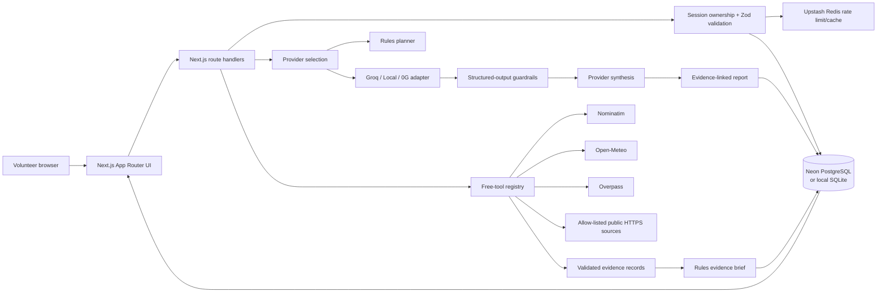
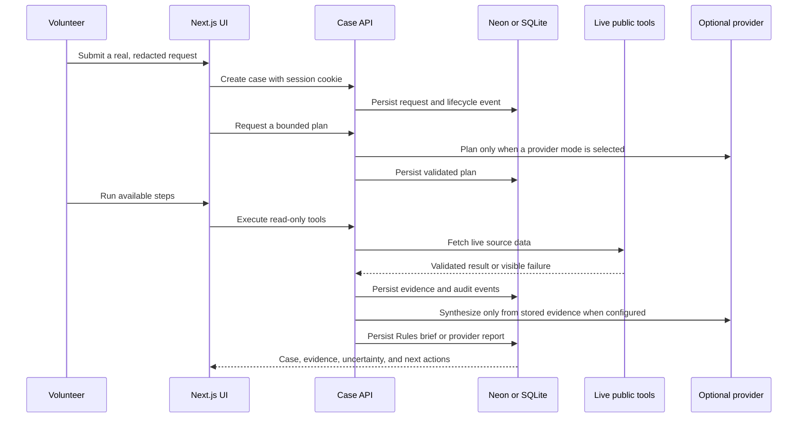
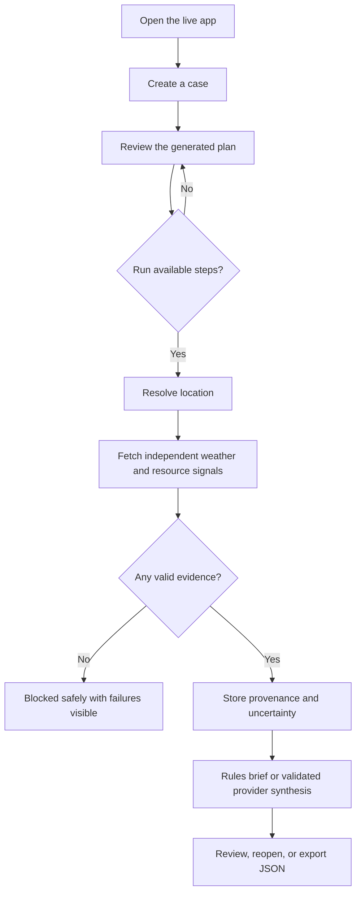
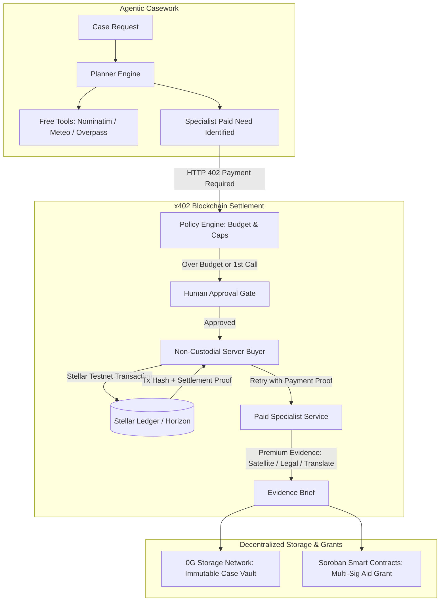

# ImpactRelay

<p align="center">
  
</p>

<h2 align="center">Evidence before confidence</h2>

<p align="center">
  An evidence-first AI caseworker for community-support requests.
</p>

<p align="center">
  <a href="https://impact-relay-olive.vercel.app/">Live demo</a> ·
  <a href="https://youtu.be/NPm6RePomjs">Demo video</a> ·
  <a href="docs/README.md">Documentation</a>
</p>

ImpactRelay turns an uncertain request into a bounded plan, retrieves live public signals, records provenance, and separates retrieved facts from human verification steps. It is designed for volunteers and small organizations that need a next action they can inspect and defend—not an opaque chatbot answer.

> **Current product boundary:** the casework, live free-tool, Neon, Redis, Rules, and Groq flows are implemented and tested. Stellar/x402 payments, authenticated accounts, and side-effecting actions are intentionally not implemented yet. The application never presents those future integrations as working.

## Live links

| Resource | Link |
| --- | --- |
| Hosted application | [impact-relay-olive.vercel.app](https://impact-relay-olive.vercel.app/) |
| Demo video | [Watch the ImpactRelay demo on YouTube](https://youtu.be/NPm6RePomjs) |

## The problem

Community volunteers often receive incomplete requests such as “find help near this area” or “check whether the situation is getting worse.” A conventional chatbot can produce fluent but unverified answers, stale links, or confident guesses. The hard part is not only generating text; it is preserving the trail from the original request to the next defensible action.

## The solution

ImpactRelay provides a reviewable case desk that:

- accepts the user’s real request instead of shipping scenario data;
- converts the request into bounded, read-only steps;
- calls live public sources for location, weather, nearby mapped resources, and allow-listed guidance pages;
- stores source URL, retrieval time, freshness, confidence, metadata, and a content hash;
- keeps failed and unavailable tools visible instead of inventing results;
- supports transparent Rules planning and optional server-side Groq, Local, and 0G providers;
- persists cases locally with SQLite or durably with Neon PostgreSQL;
- protects hosted routes with Upstash Redis rate limiting;
- gives each browser session an HttpOnly ownership boundary and JSON export;
- labels model output as synthesis and keeps source-backed evidence distinct from recommendations.

## Example use case

A volunteer receives:

> “Find nearby shelters and public guidance near Guwahati after heavy rain. Check the current weather and prepare a reviewable checklist. Do not claim that any resource is open or has capacity unless a source proves it.”

ImpactRelay can resolve the place through OpenStreetMap, retrieve current weather from Open-Meteo, attempt a nearby-resource search through Overpass, and produce a report that distinguishes:

1. **Retrieved signals** — what the live adapters returned.
2. **Human verification** — what a volunteer should confirm locally.
3. **Uncertainty** — unavailable services, unverified capacity, stale information, or missing context.

The example above is documentation only. Runtime cases come from the current user’s input and live adapter responses.

## Architecture



### Runtime data path



### Normal-user workflow



## What is live and what is deterministic?

| Capability | Runtime behavior |
| --- | --- |
| Case input | Real user input, validated and persisted |
| Rules mode | Deterministic planner/report built from the current request and live evidence; no fake LLM response |
| Groq/Local/0G modes | Real OpenAI-compatible provider request with structured-output validation; failures are surfaced |
| Location | Live OpenStreetMap Nominatim request |
| Weather | Live Open-Meteo request using resolved coordinates |
| Nearby resources | Live OpenStreetMap Overpass request; availability is never claimed as verified |
| Public guidance | Live HTTPS request to a configured host allow-list |
| Database | SQLite locally; Neon when `DATABASE_URL` is configured |
| Rate limiting/cache | Upstash Redis when configured; production requires it |
| Payments | Not implemented; approval route intentionally reports that no payment target exists |

There are deterministic UI labels, empty states, documentation examples, and offline test fixtures. They are not presented as live case evidence. The application runtime does not import test fixtures or fabricate provider/source results.

## Technology stack

| Layer | Technology | Role |
| --- | --- | --- |
| Runtime | Node.js `22.14.0`, npm `11.x` | Pinned, reproducible JavaScript runtime |
| Web framework | Next.js `16.4.2` App Router | Pages, route handlers, server/client boundaries |
| UI | React `19.3.0`, Tailwind CSS `4.3.3` | Responsive case desk and landing page |
| Interaction | Framer Motion `12.43.0`, Lucide React | Accessible motion and interface icons |
| Validation | TypeScript `5.9.3`, Zod `4.6.7` | Domain contracts and provider/tool guardrails |
| Local persistence | Node SQLite / `data/impactrelay.sqlite` | Portable development storage |
| Hosted persistence | Neon Serverless `1.0.1` | Durable PostgreSQL case storage |
| Hosted infrastructure | Upstash Redis `1.34.4`, Ratelimit `2.0.7` | Cache and sliding-window route protection |
| Testing | Vitest `3.2.4`, Testing Library, Playwright `1.52.0` | Offline contracts and browser acceptance tests |
| Delivery | Docker, GitHub Actions, Vercel-compatible Next.js deployment | Reproducible build and hosted execution |

## Supported AI Models & Providers

ImpactRelay is built on a provider-agnostic AI abstraction layer. It supports both cloud-hosted high-throughput accelerators and decentralized/local offline runtimes with structured JSON guardrails:

| Mode | Provider / Engine | Tested & Supported Models | Key Capabilities | Configuration |
| --- | --- | --- | --- | --- |
| **Rules** *(Default)* | Deterministic State Engine | Heuristic rule-based expert planner | **Zero credentials required**. 100% deterministic, offline, free forever, zero hallucination risk | `APP_MODE=rules` |
| **Groq** | Groq Cloud LPU™ Inference | `openai/gpt-oss-20b` *(default)*<br>`llama-3.3-70b-versatile`<br>`llama-3.1-8b-instant` | Near-instant structured plan generation and case synthesis with high JSON schema adherence | `APP_MODE=groq`<br>`GROQ_API_KEY`<br>`GROQ_MODEL` |
| **0G Compute** | 0G Decentralized AI Network | `deepseek-r1-distill-llama-70b`<br>`llama-3.3-70b-instruct`<br>`qwen-2.5-72b-instruct` | Decentralized inference routing via 0G Compute Router with optional TEE private trust modes | `APP_MODE=0g`<br>`OG_COMPUTE_API_KEY`<br>`OG_COMPUTE_BASE_URL`<br>`OG_COMPUTE_MODEL` |
| **Local** | Local OpenAI-Compatible Server | `llama3.2`, `mistral`, `qwen2.5`, `deepseek-r1`, `phi-3` via Ollama / vLLM / LocalAI | 100% private execution on your own hardware; no external cloud calls or data leakage | `APP_MODE=local`<br>`LOCAL_LLM_BASE_URL`<br>`LOCAL_LLM_MODEL` |

> **Provider Selection:** Set `APP_MODE` in `.env.local` to pin the runtime mode globally, or omit it to allow interactive provider selection directly from the casework interface. All provider responses pass through Zod runtime schema validation and sanitization guardrails before being admitted to the case state.

## Clean Linux rebuild & quick start

This project is fully rebuildable from scratch on a clean Linux machine with no external credentials required.

### 1. Requirements

- **Runtime**: Node.js `22.14.0` (pinned in [.nvmrc](.nvmrc) and [.node-version](.node-version))
- **Package Manager**: npm `>=10.0.0` (pinned in `package.json` engines)
- **Lockfile**: [package-lock.json](package-lock.json) (install with `npm ci`)

### 2. Setup

```bash
# Clone the repository
git clone https://github.com/thisisouvik/ImpactRelay.git
cd ImpactRelay

# Install exact dependencies from the lockfile
npm ci

# Configure local environment (default Rules mode requires zero credentials)
cp .env.example .env.local
```

### 3. Run

**Development server:**
```bash
npm run dev
# Open http://localhost:3000
```

**Production build and run:**
```bash
npm run build
npm start
# Open http://localhost:3000
```

**Docker build and run:**
```bash
docker build -t impactrelay .
docker run --rm -p 3000:3000 impactrelay
# Open http://localhost:3000
```

### 4. Test (one command)

Run the full offline unit and integration test suite with one command:
```bash
npm test
```

To run the complete production gate (linter, TypeScript typecheck, test suite, and production build):
```bash
npm run check
```

The gate runs ESLint, TypeScript, the offline Vitest suite, and the Next.js production build. Browser acceptance tests run separately:

```bash
npm run test:e2e
```

The normal browser suite uses an isolated Rules/SQLite server and does not consume provider quota. To opt into the real Nominatim/Open-Meteo browser test:

```bash
IMPACTRELAY_LIVE_TOOLS=1 npm run test:e2e
```

PowerShell:

```powershell
$env:IMPACTRELAY_LIVE_TOOLS = "1"
npm run test:e2e
Remove-Item Env:IMPACTRELAY_LIVE_TOOLS
```

For bounded live credential checks, use:

```bash
node scripts/check-integrations.mjs
node scripts/check-integrations.mjs --infer
```

The script prints only safe status, model availability, redacted provider error codes, and quota headers. It can check Groq, Neon `SELECT 1`, and Redis `PING`; it does not replace the full application smoke test.

## Hosted deployment

The deployed demo is at [impact-relay-olive.vercel.app](https://impact-relay-olive.vercel.app/). A production deployment should configure:

```env
APP_MODE=rules
NEXT_PUBLIC_APP_URL=https://your-domain.example
DATABASE_URL=your-neon-connection-string
UPSTASH_REDIS_REST_URL=https://your-upstash-endpoint
UPSTASH_REDIS_REST_TOKEN=your-upstash-token
RATE_LIMIT_MODE=required
REDIS_CACHE_PREFIX=impactrelay
```

Production rejects the SQLite fallback and requires Redis-backed request protection. Add `GROQ_API_KEY` and `GROQ_MODEL` only when the account and model have been tested. See [docs/deployment.md](docs/deployment.md) for the Vercel checklist and [docs/manual-testing-guide.md](docs/manual-testing-guide.md) for the normal-user hosted smoke test.

The repository also includes a pinned Node 22 Dockerfile and GitHub Actions workflow:

```bash
docker build -t impactrelay .
docker run --rm -p 3000:3000 --env-file .env.local impactrelay
```

## Documentation directory

The [`docs/`](docs/README.md) directory is the product and engineering source of truth. It keeps scope, safety boundaries, deployment instructions, and decisions out of scattered code comments.

| Document | Purpose |
| --- | --- |
| [docs/README.md](docs/README.md) | Documentation index, rules, and current phase |
| [docs/idea.md](docs/idea.md) | Users, problem, product principles, and MVP boundary |
| [docs/design.md](docs/design.md) | Visual language, interaction model, and accessibility direction |
| [docs/technical architecture.md](docs/technical%20architecture.md) | System boundaries, data flow, and repository ownership |
| [docs/implementation.md](docs/implementation.md) | Implementation phases, acceptance criteria, and definition of done |
| [docs/deployment.md](docs/deployment.md) | Runtime pinning, Docker, hosted configuration, and deployment checks |
| [docs/env-credentials.md](docs/env-credentials.md) | Provider, Neon, Redis, and safe credential setup |
| [docs/manual-testing-guide.md](docs/manual-testing-guide.md) | Normal-user desktop, mobile, hosted, and live-tool checklist |
| [docs/testing.md](docs/testing.md) | Unit, integration, provider, tool, and browser test strategy |
| [docs/security.md](docs/security.md) | Privacy, prompt injection, session ownership, and payment boundaries |
| [docs/demo-runbook.md](docs/demo-runbook.md) | Reproducible recording and judging flow |
| [docs/0g-implementation.md](docs/0g-implementation.md) | Implemented 0G Compute boundary and deferred 0G Storage work |
| [docs/decisions/](docs/decisions/) | Architecture decision records that should not be silently reversed |

## Repository layout

```text
app/                 Next.js pages, route handlers, and global styles
components/          UI, landing, case, evidence, and dashboard components
lib/                 Domain schemas, repositories, providers, tools, security, and infrastructure
scripts/             Explicit live integration diagnostics
services/            Reserved boundaries for future paid specialist services
tests/               Offline unit/integration tests and Playwright acceptance tests
docs/                Product, architecture, security, deployment, and testing documentation
public/              Logo and browser assets
Dockerfile           Reproducible Node 22 production image
```

Generated build output, local databases, test results, environment files, dependencies, and TypeScript build metadata are ignored by Git. Empty `.gitkeep` placeholders are intentionally not part of the repository; directories appear when their first meaningful file is added.

## Current Boundaries & Future Implementation

### Implemented Now

- **Evidence-First Casework**: User-created case intake with session ownership and privacy boundaries.
- **Multi-Provider AI Abstraction**: Deterministic Rules expert planner, Groq high-speed cloud inference, 0G Compute decentralized routing, and local LLM runtime support with Zod guardrails.
- **Live Public Signal Adapters**: Real-time OpenStreetMap Nominatim geocoding, Open-Meteo weather observations, Overpass nearby emergency resources, and allow-listed public guidance fetching.
- **Hybrid Storage & Edge Protection**: Local SQLite persistence with seamless Neon Serverless PostgreSQL switching; Upstash Redis sliding-window rate limiting and response caching.
- **Provenance & Audit Trails**: Every claim carries source URLs, retrieval timestamps, freshness indicators, confidence tiers, and SHA-256 content hashes with JSON export.
- **Continuous Quality Gate**: 100% passing offline unit and integration test suites (10 suites, 91 tests), linting, TypeScript type safety, and multi-stage Docker builds.

---

### Future Implementation & Blockchain Integration

The long-term vision of ImpactRelay is to bridge autonomous AI agents with **verifiable, decentralized Web3 infrastructure**, solving the critical trust and accountability problems that arise when AI agents interact with the physical world and financial resources.



#### 1. Stellar Network & x402 Machine-to-Machine Micropayments

* **The Problem:** Autonomous agents that hold private keys or make open-ended financial decisions pose extreme risk of wallet drainage or unauthorized spending. Conversely, forcing volunteers to subscribe to multiple expensive enterprise data APIs makes community relief casework unaffordable.
* **The Solution (HTTP 402 on Stellar):** ImpactRelay implements the emerging **x402 standard** for machine-to-machine micropayments on the **Stellar Network**:
  * **On-Demand Pay-per-Call:** When the agent needs high-resolution satellite flood imagery, commercial crisis logistics feeds, or certified dialect translations, the specialist service returns `HTTP 402 Payment Required` with a price quote (e.g. 0.05 XLM / $0.01) and destination address.
  * **Bounded Autonomy & Human-in-the-Loop:** A strict server-side policy engine enforces per-call budget ceilings (e.g. max $0.05) and cumulative case limits (e.g. max $0.20). The first payment requires explicit one-click caseworker approval in the UI.
  * **Non-Custodial Architecture:** The server acts as a non-custodial buyer proxy utilizing a dedicated, disposable Stellar Testnet signing key. The caseworker's personal wallet and private keys are never exposed to the browser or agent logic.
  * **On-Chain Audit Receipts:** Upon settlement (3–5 second finality with negligible fees on Stellar), the resulting transaction hash (`tx_hash`) and ledger sequence are permanently embedded into the case file as immutable cryptographic proof of purchase.

#### 2. 0G Decentralized Storage Network (Immutable Case Vault)

* **Tamper-Proof Case Archival:** Once a case brief is finalized, the encrypted audit trail, evidence ledgers, and payment receipts will be published to the **0G Decentralized Storage Network**.
* **Cryptographic Merkle Proofs:** Generates an immutable content hash and Merkle root proof for every case. Donors, humanitarian agencies, and independent auditors can verify the exact sequence of facts and financial transactions without needing access to a centralized server or database.

#### 3. Soroban Smart Contract Micro-Grants & Multi-Sig Aid

* **Community Relief Pools:** Relief organizations and community donors can pool disaster funds into **Soroban smart contracts** on Stellar.
* **Evidence-Backed Grant Proposals:** When a case report identifies verifiable emergency needs (e.g., immediate temporary shelter or emergency supply vouchers), ImpactRelay prepares an automated on-chain disbursement proposal tied directly to the verified evidence items.
* **Multi-Signature Human Approval:** Designated field volunteers or relief treasurers multi-sign the contract proposal to release micro-grants directly to verified recipients or local vendor wallets, eliminating bureaucratic delay while maintaining transparency.

#### 4. Decentralized Identity (DID) & Zero-Knowledge Verification

* **Caseworker Credentials:** Integration with W3C Verifiable Credentials (VCs) and Soulbound decentralized identity tokens, allowing volunteer caseworkers to verify their organizational accreditation without doxxing themselves.
* **Privacy-Preserving Victim Eligibility:** Utilizing Zero-Knowledge Proofs (ZKP) to prove that an applicant resides within a federally declared disaster zone and qualifies for assistance without storing or leaking sensitive Personal Identifying Information (PII) on-chain.

## License and contribution note

This repository is a hackathon project. Keep changes focused, preserve the no-fabrication boundary, update the relevant documentation, and run `npm run check` before handing off work. Do not commit `.env`, local database files, provider keys, private data, or generated build artifacts.
